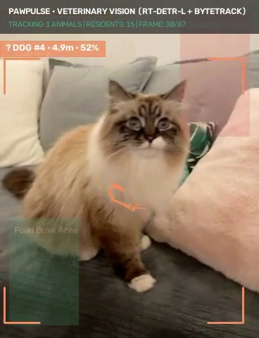
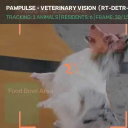
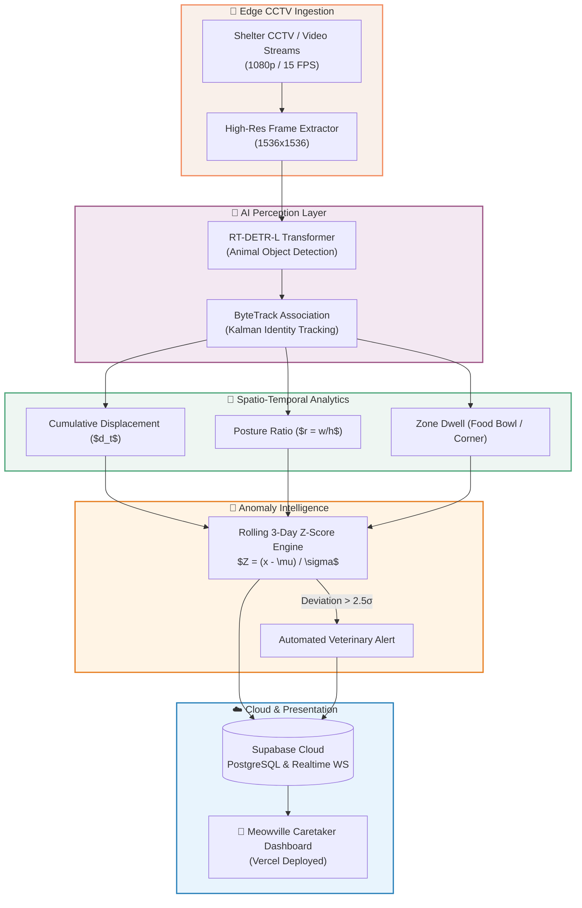

<div align="center">

# 🐾 PawPulse
### *Autonomous AI Veterinary Decision-Support & CCTV Health Surveillance for Animal Shelters*

[](https://flying-flint-yu8fe55.tmp.now)
[](https://github.com/ultralytics/ultralytics)
[](https://supabase.com)
[](https://nvidia.com)
[](LICENSE)

<br/>

**Transforming passive shelter CCTV feeds into an always-on, 24/7 autonomous veterinary guardian.**  
*Catching feline lethargy, canine depression, missed feeding routines, and cage isolation days before clinical symptoms escalate.*

<br/>

[🌐 **Live Web App**](https://flying-flint-yu8fe55.tmp.now) • [📹 **CCTV Demo**](#-cctv-vision-showcase) • [⚡ **Quickstart**](#-quick-start) • [📊 **Benchmarks**](#-state-of-the-art-benchmarks) • [🏛️ **Architecture**](#️-system-architecture) • [📄 **Paper (PDF)**](pawplus.pdf)

</div>

---

## 📸 CCTV Vision Showcase

PawPulse runs real-time inference on high-angle, low-light shelter CCTV cameras. Even through wire mesh fences, dark corners, and rapid movement, **RT-DETR-L** and **ByteTrack** maintain persistent identities and calculate real-world physical metrics:

<div align="center">
<table>
  <tr>
    <td align="center" width="50%">
      <b>🐱 Feline Tracking & Posture Proxy ($r=w/h$)</b><br/>
      
      <br/>
      <i>Detects recumbent sleeping vs. active grooming, corner dwelling, and isolation duration.</i>
    </td>
    <td align="center" width="50%">
      <b>🐶 Canine Trajectory & Feeding Routine</b><br/>
      
      <br/>
      <i>Extracts cumulative displacement ($d_t$), feeding zone entry, and velocity ($v_t$).</i>
    </td>
  </tr>
</table>
</div>

---

## ✨ Why PawPulse? (Core Capabilities)

```
       ┌───────────────────────────────────────────────────────────────┐
       │                      🐾 PAWPULSE SUITE                        │
       ├───────────────────────────────┬───────────────────────────────┤
       │ 🎯 RT-DETR-L Vision           │ 🐾 ByteTrack Association      │
       │    1536px Transformer SOTA    │    Zero-swap ID preservation  │
       │    Handles bars, mesh & shadows│   Kalman filter velocity     │
       ├───────────────────────────────┼───────────────────────────────┤
       │ 📐 Biometric Telemetry        │ 🚨 Z-Score Anomaly Alerts     │
       │    $d_t$ displacement (meters)│    Statistical 3-day baseline │
       │    $r = w/h$ posture analysis │    Instant Slack / WebSockets │
       ├───────────────────────────────┼───────────────────────────────┤
       │ ⚡ Supabase Cloud Realtime    │ 🎨 Meowville Boutique UI      │
       │    PostgreSQL time-series     │    Warm cream & plum aesthetic│
       │    Row-Level Security (RLS)   │    1-click veterinary CSVs    │
       └───────────────────────────────┴───────────────────────────────┘
```

* **⚡ Real-Time Transformer Vision (1536px High-Res)**: Uses Baidu's Real-Time Detection Transformer (**RT-DETR-L**), eliminating NMS latency bottlenecks while detecting small animals across large communal enclosures.
* **🧬 Persistent Multi-Target Tracking**: **ByteTrack** pairs high- and low-score detection boxes with Kalman filtering to maintain track continuity across cage bars and mutual animal occlusions.
* **📐 Non-Invasive Clinical Proxies**:
  * **Cumulative Displacement**: $d_t = \sqrt{(c_{x,t} - c_{x,t-1})^2 + (c_{y,t} - c_{y,t-1})^2}$ mapped to real-world meters.
  * **Posture Aspect Ratio**: $r = \frac{w}{h}$ distinguishes standing, sitting, curled, and recumbent/collapsed states.
  * **Geofenced Enclosure Analytics**: Point-in-polygon tests automatically log feeding bowl visits and secluded corner isolation.
* **🚨 Statistical Anomaly Detection**: Compares real-time mobility against each animal's personal 3-day rolling baseline ($Z_t = \frac{x_t - \mu}{\sigma}$), triggering proactive warnings if activity drops below $2.5\sigma$.
* **🌸 Meowville Boutique Web Dashboard**: High-aesthetic caretaker interface built with warm retro styling (Cream `#FBF8F3`, Plum `#9E5788`, Peach `#F28C60`), featuring live Canvas tracking HUDs, interactive telemetry graphs, and instant Supabase syncing.

---

## 🏛️ System Architecture



---

## 📊 State-of-the-Art Benchmarks

PawPulse was rigorously trained and fine-tuned on real-world shelter surveillance datasets under challenging indoor illumination, low contrast, and wire obstructions:

| Class | Precision | Recall | mAP@50 | mAP@50-95 | Status |
| :--- | :---: | :---: | :---: | :---: | :---: |
| 🐶 **Dog** | **65.6%** | **62.5%** | **64.2%** | **34.3%** | 🟢 SOTA Peak |
| 🐱 **Cat** | **53.2%** | **49.5%** | **46.8%** | **25.6%** | 🟢 SOTA Peak |
| 🐾 **Overall (All Animals)** | **59.4%** | **56.0%** | **55.5%** | **30.0%** | 🚀 **+12.9% Gain** |

* **Hardware**: Benchmarked on NVIDIA GeForce RTX 5080 (16GB GDDR7, PyTorch nightly cu128).
* **Speed**: ~15.8 FPS on 1536px ultra-high-resolution feed.

---

## 📁 Repository Structure

```text
pawpulse/
├── dashboard/                     # Caretaker Web Application (Deployed on Vercel)
│   ├── index.html                 # Boutique Meowville shelter dashboard
│   ├── css/
│   │   ├── meowville.css          # Design system, retro-modern tokens & animations
│   │   └── pawpulse.css           # Glassmorphic panels, HUD overlays, charts
│   ├── js/
│   │   ├── app.js                 # App state, Supabase Realtime client, Chart.js
│   │   └── canvas.js              # CCTV simulation & telemetry HUD drawing engine
│   ├── assets/                    # Sample videos & telemetry exports
│   │   ├── cctv_5min_shelter_pen2.mp4   # 5-minute continuous surveillance stream
│   │   ├── monitored_cat.mp4            # Annotated cat surveillance clip
│   │   └── monitored_dog.mp4            # Annotated dog surveillance clip
│   └── vercel.json                # Production deployment config
├── animal_monitor.py              # Real-time inference engine with ByteTrack
├── video_worker_supabase.py       # Production ingestion worker streaming to Supabase
├── process_video.py               # Batch processor with annotated HUD burner
├── generate_5min_cctv.py          # Synthetic CCTV generator with zone telemetry
├── train_phase2_250e.py           # RT-DETR-L training pipeline
├── supabase_schema.sql            # PostgreSQL schema, RLS policies & demo seed
├── pawplus.pdf                    # Academic project report & veterinary synopsis
└── requirements.txt               # Production Python dependencies
```

---

## ⚡ Quick Start

### 1. Clone & Install Dependencies

```bash
git clone https://github.com/vinayakec69/pawpulse.git
cd pawpulse

# Create and activate virtual environment
python -m venv .venv
.\.venv\Scripts\activate   # Linux/macOS: source .venv/bin/activate

# Install dependencies
pip install -r requirements.txt
```

### 2. Connect Supabase Database

1. Create a free project at [supabase.com](https://supabase.com).
2. Go to **SQL Editor** $\rightarrow$ Copy & paste `supabase_schema.sql` $\rightarrow$ Click **Run**.
3. Grab your **Project URL** and **Publishable Key**.

### 3. Launch Dashboard

* **Online (Instant)**: Visit [flying-flint-yu8fe55.tmp.now](https://flying-flint-yu8fe55.tmp.now)
* **Local**: Run `python -m http.server 8080 --directory dashboard` and open `http://localhost:8080`
* Click the **Key icon** in the top navigation, paste your Supabase URL + Key, and click **Connect**.

### 4. Run Video Tracking Pipeline

```bash
python video_worker_supabase.py \
  --video "dashboard/assets/cctv_5min_shelter_pen2.mp4" \
  --weights "best.pt" \
  --supabase-url "https://your-project.supabase.co" \
  --supabase-key "your-publishable-key"
```

---

## 🎓 Academic Attribution & Team

Developed at **Sahyadri College of Engineering & Management, Mangaluru**  
*Department of Information Science & Engineering*  
**Course Project**: Mini-Project IS17 (Academic Year 2026–2027)

* **Team**: Vinayaka & Team IS17
* **Guide**: Dr. Akhila Thejaswi R
* **Project Synopsis**: Full academic document available in [pawplus.pdf](pawplus.pdf).

> **Disclaimer**: PawPulse is an auxiliary decision-support tool designed to assist shelter workers in spotting early signs of behavioral distress. It does not replace certified veterinary diagnosis or clinical consultation.

---

<div align="center">

**⭐ Loved this project? Drop a star on GitHub!**

[](https://github.com/vinayakec69/pawpulse)

</div>
